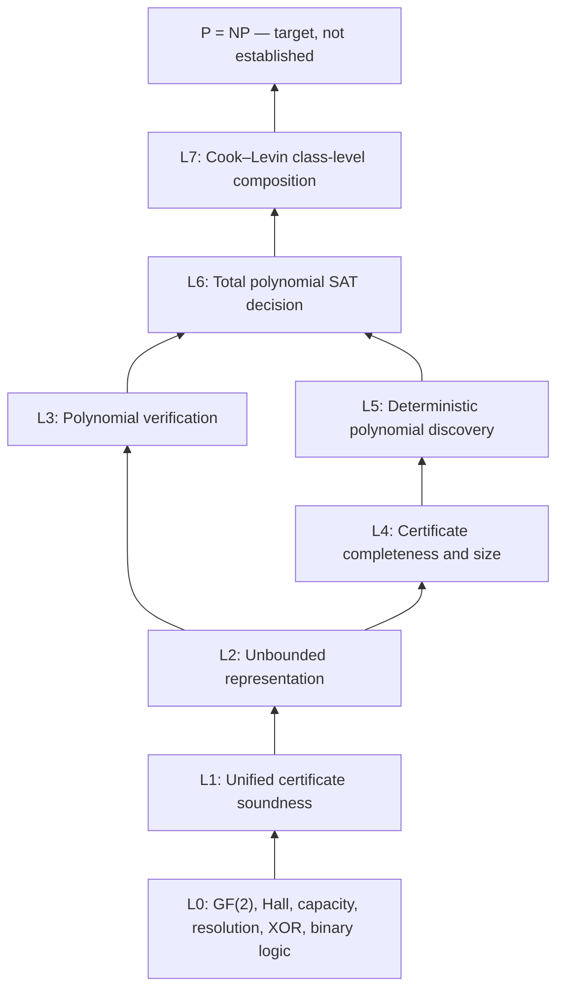

# MathOS — Reverse engineering the P vs NP resolution theorem

**Technical framework:** Topological Gap Analysis Ω — Backward Proof Construction  
**Version:** 1.0, 25 November 2026  
**Classification:** Public technical research note; not peer-reviewed; no resolution claimed.  
**Resolution status:** PNP_RESOLUTION_STATUS = OPEN

## Abstract

Instead of extending an existing theorem sequence forward, this note decomposes a final P versus NP resolution theorem backward into explicit mathematical and computational obligations. It connects these obligations to MathOS's verified GF(2), Hall-deficiency, capacity, resolution, XOR, binary-checker and resource-accounting foundations. The positive route distinguishes sound verification, ordinary certificate existence, polynomial certificate size, deterministic polynomial discovery, and the complete computational cost of deciding SAT. The alternative negative route requires a lower bound against every uniform deterministic polynomial-time SAT algorithm. The objective is an uninterrupted, logically valid proof dependency path from verified foundations to an unrestricted complexity-class theorem. Topological Gap Analysis Ω is used here as an authored AND/OR dependency model, not as a proof of its open premises or a numerical measure of proximity to a solution.

## 1. Define the final target

The positive resolution target is

$$\boxed{P=NP}.$$

By the Cook–Levin theorem and the NP-completeness of 3-SAT, a sufficient condition is one uniform deterministic algorithm $A$ and fixed constants $c,k\in\mathbb{N}$, with $c>0$, such that for every valid encoded 3-CNF formula $F$,

$$
\begin{aligned}
A(F)=1 &\iff F\text{ is satisfiable},\\
T_A(F)&\le c(1+|F|)^k.
\end{aligned}
$$

| Symbol | Technical meaning |
|---|---|
| $A$ | One uniform deterministic algorithm |
| $F$ | Arbitrary finite 3-CNF formula |
| $N=|F|$ | Encoded input length |
| $T_A(F)$ | Total running time in a specified standard bit-machine model |
| $c,k$ | Fixed constants independent of the input |

The machine must also specify its behavior on malformed encodings. The requirement is not that MathOS solve a large collection of SAT instances, but that a single algorithm decide every instance with a uniform polynomial worst-case time bound.

## 2. Reverse-engineered dependency architecture

The proposed certificate-based positive route is:




| Layer | Technical dependency | Evidence status at this snapshot |
|---|---|---|
| L0 | Existing MathOS foundations | Scoped kernel-verified results |
| L1 | Unified certificate soundness | Verified for existing typed and bounded byte checkers |
| L2 | Unbounded representation | Unbounded token roundtrip and byte-checker soundness verified on F035 head; universal decimal encoding and total cost remain open |
| L3 | Polynomial verification | Selected resource bounds verified; unbounded total bit cost open |
| L4 | Certificate completeness | Ordinary typed completeness has a 19-declaration zero-axiom log, but its complete workflow failed in the executable harness; serialized completeness and polynomial size remain open |
| L5 | Deterministic polynomial discovery | Open — decisive gap |
| L6 | Total SAT decision | Conditional decision bridge verified; actual polynomial generator and total cost open |
| L7 | Complexity-class composition | Established classical implication, hypothesis not supplied |

Arrows indicate the direction of proof construction. The requirements were derived backward from the target. This is one sufficient MathOS route, not a claim that every proof of P = NP must follow it. Some work packages overlap logically: in a bit model efficient discovery already entails polynomial output size. An independent review is a publication/evidence gate rather than a mathematical premise.

The executable authored dependency graph is available in [F035](https://github.com/tltmgnt/MathOS/blob/7c38746dbb63e82dfe781c6cbe32ff6d483bebe7/mathos/research/tga_pnp_resolution_gap.py). Its minimal completion sets are relative to its modeled routes.

## 3. Mathematical reverse construction

### Layer 7 — Complexity-class bridge

Suppose a deterministic polynomial-time algorithm $A$ for 3-SAT exists. For every language $L\in NP$, there exists a uniform polynomial-time many-one reduction $r_L$ satisfying

$$x\in L\iff r_L(x)\in\mathrm{3SAT}.$$

Define $D_L(x)=A(r_L(x))$. Polynomial-time computation is closed under composition, so $NP\subseteq P$. Since $P\subseteq NP$, we obtain $P=NP$. This is an established classical implication, not a new MathOS discovery. Its hypothesis is the central unresolved obligation.

### Layer 6 — Total decision construction

Let $C(F,\pi)$ be a sound Boolean UNSAT certificate checker and $G(F)$ a proposed deterministic generator. Assume a known uniform polynomial cutoff $p(N)$ for accepted-certificate discovery on all unsatisfiable inputs. The conditional decision construction is:

```python
# CONDITIONAL SPECIFICATION, NOT AN ESTABLISHED POLYNOMIAL SAT SOLVER.
def decide_sat(formula):
    certificate = bounded_generate(formula)  # fixed polynomial cutoff
    if certificate is not None:
        if verify_unsat(formula, certificate):
            return UNSAT
    return SAT  # justified ONLY by the universal discovery theorem
```


If an accepted certificate exists after bounded generation, soundness establishes UNSAT. If none exists, the answer SAT is justified only by a proof that the generator always succeeds within its budget on every UNSAT formula. Until then, the actual heuristic solver must retain UNKNOWN on unsuccessful search.

F035 formalizes the conditional typed decision equivalence under the explicit DiscoveryComplete hypothesis. It does not supply an unconditional efficient generator. The SAT equivalence also uses a constructive satisfiable-or-unsatisfiable alternative. [Lean source](https://github.com/tltmgnt/MathOS/blob/7c38746dbb63e82dfe781c6cbe32ff6d483bebe7/formal/ProctorResolutionBridge.lean).

### Layer 5 — Polynomial certificate discovery

The missing theorem is

$$
\exists G,\ p\text{ polynomial}\ \forall F\in\mathrm{UNSAT}:
\quad C(F,G(F))=1,\qquad T_G(F)\le p(|F|).
$$

Here $G$ is uniform and deterministic; the decision procedure can enforce the known cutoff on every input. In the standard bit model the generated certificate has polynomial encoded size. Efficient verification and the cutoff together then give a deterministic polynomial UNSAT decision algorithm, and hence a polynomial SAT algorithm by complementing its answer.

A certificate may be short and easy to verify but computationally difficult to discover.

### Layer 4 — Polynomial certificate existence

The separate size target is

$$
\exists p\text{ polynomial}\ \forall F\in\mathrm{UNSAT}\
\exists\pi:\quad C(F,\pi)=1\land|\pi|\le p(|F|).
$$

The polynomial must be uniform over arbitrary valid encodings. For a sound proof system, polynomial-time verification and polynomial-size completeness imply $\mathrm{UNSAT}\in NP$, and hence $NP=coNP$. They do not by themselves imply $P=NP$. Deterministic polynomial discovery closes the additional gap.

Ordinary completeness, by contrast, merely establishes $\forall F\in\mathrm{UNSAT}\ \exists\pi:C(F,\pi)=1$, without a polynomial size guarantee. The F035/F038 candidate proves this for the unrestricted typed checker by finite assignment splitting and frontier-preserving resolution compilation. It can construct exponentially large proofs; it does not yet cover every valid serialized envelope.

## 4. Reverse engineering the computational cost

Let $N$ be expected formula encoding length, $M$ be certificate-envelope encoding length, $B=N+M$ their combined byte length (for the present wire format), and $w$ the binary operand width. For a full asymptotic theorem, use an explicit bit encoding and account for conversion between size measures.

### Verified seven-coordinate front-end resource theorem

The existing bounded front-end ledger establishes the coordinatewise bound

$$
\mathbf{R}_{\mathrm{front}}\preceq
\begin{pmatrix}
5235B\\
1046B+16\\
20B\\
1047B\\
21B\\
1536B\\
64B+6
\end{pmatrix}.
$$

| Coordinate | Selected resource ceiling |
|---|---:|
| Scanner comparison gates | $5235B$ |
| Narrowing and zero-test visits | $1046B+16$ |
| Byte prepass visits | $20B$ |
| Padding visits | $1047B$ |
| Digit encoder events | $21B$ |
| Abstract token emission events | $1536B$ |
| Selected token grammar events | $64B+6$ |

These are independent conservative reservations, not a single machine execution trace. The grammar meter is an alternative instrumented implementation; equality of results does not establish cost equivalence. This theorem uses fixed-width scanner parameters and does not automatically generalize to the unbounded decoder. [Strict Lean evidence](https://github.com/tltmgnt/MathOS/actions/runs/45626656164/job/139248536651), [PR #237](https://github.com/tltmgnt/MathOS/pull/237).

### Candidate closed polynomial checker ceilings

Source-level budget definitions motivate the following proof targets in terms of explicit combined encoding mass. These asymptotic expressions are **not new kernel-verified global bounds**.

| Component | Candidate selected-resource ceiling |
|---|---|
| Input binding | $O(wB)$ |
| Proof-range validation | $O(wB)$ |
| Resolution-chain comparisons | $O(wB^3)$ |
| XOR terminal comparisons | $O(wB^2)$ |
| Capacity terminal comparisons | $O(wB^4)$ |
| Aggregate lookup visits | $O((w+1)B^3)$ |

A proof must account for actual aggregate masses and evolving frontiers, including malformed/rejected input and all relevant guards, rather than assuming each nested iteration is constant time. These selected gate/visit counts exclude other operations.

### Capacity example

For $D$ explicitly represented demand rows, the verified per-pair selected lookup reservation is at most $2(w+1)D$. There are $D^2$ ordered pairs. Consequently the mathematical aggregate estimate is

$$V_{\mathrm{pairs}}\le D^2\cdot2(w+1)D=2(w+1)D^3.$$

For $w=512$, this is $1026D^3$. The aggregate closed form is an algebraic consequence of the budget structure; a separate Lean closed-form audit is not asserted here.

The capacity guard restricts word enumeration to lengths $k\in\{1,2,3\}$. A group of $g$ literals has $g^k$ words at its selected length, bounded by $g^3$ for integer $g\ge1$ (and zero when $g=0$). Each word requires distinctness/conflict comparisons over explicitly represented rows. Aggregate group literal mass and conflict-row mass offer a route to a fourth-degree selected comparison ceiling. Reference lookups, pair disjointness, and coverage must also be charged.

Sources: [capacity ledger PR #235](https://github.com/tltmgnt/MathOS/pull/235), [unified checker ledger PR #236](https://github.com/tltmgnt/MathOS/pull/236), [strict checker kernel evidence](https://github.com/tltmgnt/MathOS/actions/runs/45622979373/job/139235721205).

### Growth-rate illustration

| Growth | At n = 20 |
|---|---:|
| $n$ | 20 |
| $n^2$ | 400 |
| $n^3$ | 8,000 |
| $n^4$ | 160,000 |
| $2^n$ | 1,048,576 |

This is an arithmetic illustration, not measured MathOS runtime. A full cost theorem must charge allocation, traversal, encoding, arithmetic, control flow and intermediate representation sizes as well as selected gate events.

## 5. Reverse engineering the representation layer

The original bounded parser has maximum byte length 1,000,000, list length 100,000 and decimal digit count 128. Selected binary operations use 512-bit operands. A direct unbounded SAT theorem cannot rely on these fixed limits. In particular, the original checker rejects every expected byte stream longer than its byte cap independently of the certificate. F035 has kernel-verified that rejection theorem, an unbounded grammar/token roundtrip, legacy scanner-success preservation and soundness of a new unbounded byte checker using arbitrary natural numbers.

The new codec removes fixed byte, list and digit limits, but its universal decimal encoding, exact computational cost and scalable binary refinement remain open. It does not automatically inherit the old fixed-width resource ceilings.

After compactly renumbering variables and indexing explicit proof rows, a candidate width is

$$w(B)=\lceil\log_2(B+1)\rceil+c$$

for a fixed overhead $c$, provided all relevant intermediate integers are proved to fit. Larger intermediate quantities may need additional bits. For example, representing the integer $2^{20}$ requires 21 binary digits. This observation is not a universal width theorem. A safe unbounded alternative is to charge actual operand bit lengths and prove their growth bounds.

If the proposed comparison ceilings and adaptive logarithmic width theorem are established, the candidate becomes $O(B^4\log B)$ selected comparison work. It remains a verification estimate in combined formula/certificate size, not discovery time in formula size alone.

## 6. The deeper topological gap: certificate coverage

Let $U_R,U_X,U_H,U_C$ denote formulas refutable by resolution, XOR, Hall, and capacity inference, respectively. For a fixed polynomial $p$, restrict each family to formulas having accepted certificates of encoded size at most $p(N)$. Let $U_{\mathrm{mixed},p}$ be the corresponding coverage of the specified mixed proof language, including its allowed compositions.

Define

$$\boxed{\Delta_p=\mathrm{UNSAT}\setminus U_{\mathrm{mixed},p}}.$$

The universal polynomial certificate-size objective is

$$\exists p\text{ polynomial}:\quad\Delta_p=\varnothing.$$

This is a set-coverage definition, not an empirical estimate of the proportion of UNSAT instances covered. No inference about equality of the sets follows merely from overlapping inference families or adding new rules. Even a proof that $\Delta_p\ne\varnothing$ for every polynomial $p$ establishes a limitation of this particular proof system, not necessarily $P\ne NP$. Conversely, proving ordinary unrestricted completeness does not prove polynomial completeness.

The ordinary typed construction splits a finite list of occurring variable identifiers, weakens a falsified original clause to a blocking clause at each leaf, resolves the two child blocking clauses at each internal node, and compiles the resulting sequential trace into frontier-preserving batches. The complete binary splitting tree can have $2^{n+1}-1$ nodes for $n$ distinct variables; the present candidate's non-deduplicated identifier list can be longer. The proof-size and discovery gaps therefore remain substantial.

## 7. Reverse-engineered theorem execution plan

| ID | Technical target | Dependency and status |
|---|---|---|
| F035 | Unbounded representation preservation | Token grammar and conditional bridge verified; unbounded byte-encoding and cost gaps remain |
| F036 | Closed polynomial selected-resource bounds | Existing recursive ledgers; unbounded width and aggregate size proofs open |
| F037 | Total polynomial bit-machine cost | F035–F036; open |
| F038 | Unbounded ordinary mixed-certificate completeness | Typed theorem has zero-axiom log; full controls and serialized envelope bridge outstanding |
| F039 | Polynomial certificate-size completeness | F038 plus uniform size bound; open |
| F040 | Deterministic polynomial certificate discovery | Construction and uniform polynomial cutoff; open |
| F041 | Total SAT decision correctness | Soundness, complete discovery and decision adapter; conditional bridge verified |
| F042 | Uniform polynomial SAT complexity | F037, F040–F041 and total-cost analysis; open |
| F043 | Class-level composition and independent audit | F042; classical implication established, application and audit open |

F038 asks whether a proof exists. F039 asks whether a short proof exists. F040 asks whether a short proof can be found efficiently. These obligations have different logical strengths. The numbering is a research plan, not a guarantee of completion.

## 8. Proposed master resolution theorem

```text
THEOREM MathOS_PNP_Resolution   [TARGET SPECIFICATION — NOT PROVED]
INPUT: Arbitrary finite encoded 3-CNF formula F
CONSTRUCT: One uniform deterministic machine A
PROVE:
  1. A terminates on every input, with specified malformed-input behavior.
  2. A(F) = SAT iff F has a satisfying assignment (valid encodings).
  3. A(F) = UNSAT iff F has no satisfying assignment (valid encodings).
  4. Fixed c,k exist such that total_bit_cost(A,F) <= c*(1+size(F))^k.
DERIVE:
  3SAT in P; NP subset P; P subset NP.
CONCLUDE:
  P = NP.
```


This specification is not an existing proved Lean declaration. A conditional implication with an unproved efficient-generator hypothesis is insufficient to instantiate it.

## 9. Alternative negative route

The other resolution target is $P\ne NP$. A sufficient theorem is

$$
\forall A\text{ correctly deciding SAT},\
\forall c,k\in\mathbb N_{>0},\
\exists F:\quad T_A(F)>c(1+|F|)^k.
$$

This is a universal worst-case lower bound against all correct deterministic SAT machines, not just current solvers or certificate systems. A lower bound for a particular proof language can inform the research plan but cannot by itself establish this separation.

## 10. Final gap assessment

| Obligation | Status |
|---|---|
| Mathematical inference soundness | Established for the specified rules |
| Bounded serialized checker correctness | Verified |
| Selected resource accounting | Substantially established in the bounded implementation |
| Unbounded representation | Partial: token roundtrip and unbounded-checker soundness verified |
| Ordinary typed completeness | All 19 declarations axiom-free in a failed overall workflow; executable harness repair/replay required |
| Complete polynomial machine cost | Open |
| Universal short certificate existence | Open |
| Efficient certificate discovery | Open |
| Unrestricted complexity equality or separation | Open |

The central insight of backward proof construction is that a sound contradiction verifier must be distinguished from a uniform deterministic procedure guaranteed to discover contradictions in polynomial time. The positive certificate route aligns with the existing MathOS architecture, but no proof of universal polynomial existence or discovery is supplied. A dependency graph cannot prove its own unresolved premises.

**Final target:** PNP_RESOLUTION_STATUS = SOLVED, only after an actual unrestricted resolution theorem.  
**Current justified status:** PNP_RESOLUTION_STATUS = OPEN.

## Reproducibility and evidence snapshot

Frozen research baseline: [32e67cfa41d447b8b9df680bd24e99d7436104d3](https://github.com/tltmgnt/MathOS/commit/32e67cfa41d447b8b9df680bd24e99d7436104d3). The F035 and ordinary-completeness heads below are separately linked; they are not represented as merged into this baseline.

| Result | Exact source / verification |
|---|---|
| Unified binary checker equivalence and soundness | [PR #233](https://github.com/tltmgnt/MathOS/pull/233); [run 45613607279, job 139203196711](https://github.com/tltmgnt/MathOS/actions/runs/45613607279/job/139203196711) |
| Capacity selected resources | [PR #235](https://github.com/tltmgnt/MathOS/pull/235); [run 45622968605, job 139235874499](https://github.com/tltmgnt/MathOS/actions/runs/45622968605/job/139235874499) |
| Unified checker selected resources | [PR #236](https://github.com/tltmgnt/MathOS/pull/236); [run 45622979373, job 139235721205](https://github.com/tltmgnt/MathOS/actions/runs/45622979373/job/139235721205) |
| Seven-coordinate front end | [PR #237](https://github.com/tltmgnt/MathOS/pull/237); [run 45626656164, job 139248536651](https://github.com/tltmgnt/MathOS/actions/runs/45626656164/job/139248536651) |
| Unbounded token codec and conditional decision bridge | [F035 head 7c38746d](https://github.com/tltmgnt/MathOS/commit/7c38746dbb63e82dfe781c6cbe32ff6d483bebe7); [PR #238](https://github.com/tltmgnt/MathOS/pull/238), open at snapshot; [run 45634100503, job 139274794944](https://github.com/tltmgnt/MathOS/actions/runs/45634100503/job/139274794944), 36 audited declarations, zero axioms, 15 control groups, success |
| Ordinary typed completeness candidate | [head 5394f448](https://github.com/tltmgnt/MathOS/commit/5394f448c5866e109338448f2f8df99d6bf7fc03); [run 45634433783, job 139275971116](https://github.com/tltmgnt/MathOS/actions/runs/45634433783/job/139275971116), 19 zero-axiom reports followed by executable harness type mismatch (overall failure) |
| Nine-coordinate end-to-end ledger | [initial failure](https://github.com/tltmgnt/MathOS/actions/runs/45630291027); [local elaboration repair a9279084](https://github.com/tltmgnt/MathOS/commit/a92790846ee3738bde4fc05e9ae7c84327afd040), [fresh replay](https://github.com/tltmgnt/MathOS/actions/runs/45632842628), still in progress at snapshot |

Reproduce the F035 exact-source verification in an isolated checkout using the pinned Lean 4.14.0 workflow [proctor-f035-resolution-bridge.yml](https://github.com/tltmgnt/MathOS/blob/7c38746dbb63e82dfe781c6cbe32ff6d483bebe7/.github/workflows/proctor-f035-resolution-bridge.yml). The workflow checks warnings as errors, prints each audited declaration's axiom dependencies, requires the exact executable marker and checks that the authored dependency report remains BLOCKED. Passing controls and zero-axiom reports establish their stated scope only; they do not establish semantic correspondence for unmodeled operations, novelty, independent review or resolution.

## References

1. Cook, S. A. (1971). *The complexity of theorem-proving procedures*. Proceedings of the Third Annual ACM Symposium on Theory of Computing, 151–158. https://doi.org/10.1145/800157.805047.
2. Karp, R. M. (1972). *Reducibility among combinatorial problems*. In Complexity of Computer Computations, 85–103. Standard NP-completeness and polynomial reductions background.
3. Cook, S. A., and Reckhow, R. A. (1979). *The relative efficiency of propositional proof systems*. Journal of Symbolic Logic, 44(1), 36–50. Polynomial proof systems and the NP/coNP distinction.
4. MathOS, [TGA-U001 — Universal implication theorems](https://github.com/tltmgnt/MathOS/blob/32e67cfa41d447b8b9df680bd24e99d7436104d3/docs/research/tga-universal/TGA-U001.md).
5. MathOS, [F035 — Reverse resolution bridge](https://github.com/tltmgnt/MathOS/blob/7c38746dbb63e82dfe781c6cbe32ff6d483bebe7/docs/research/tga-universal/PNP-F035-REVERSE-RESOLUTION-BRIDGE.md).

This note is an unreviewed public research specification and evidence snapshot. It makes no claim of literature priority for classical implications or of an official journal publication. The original unresolved status is preserved.
